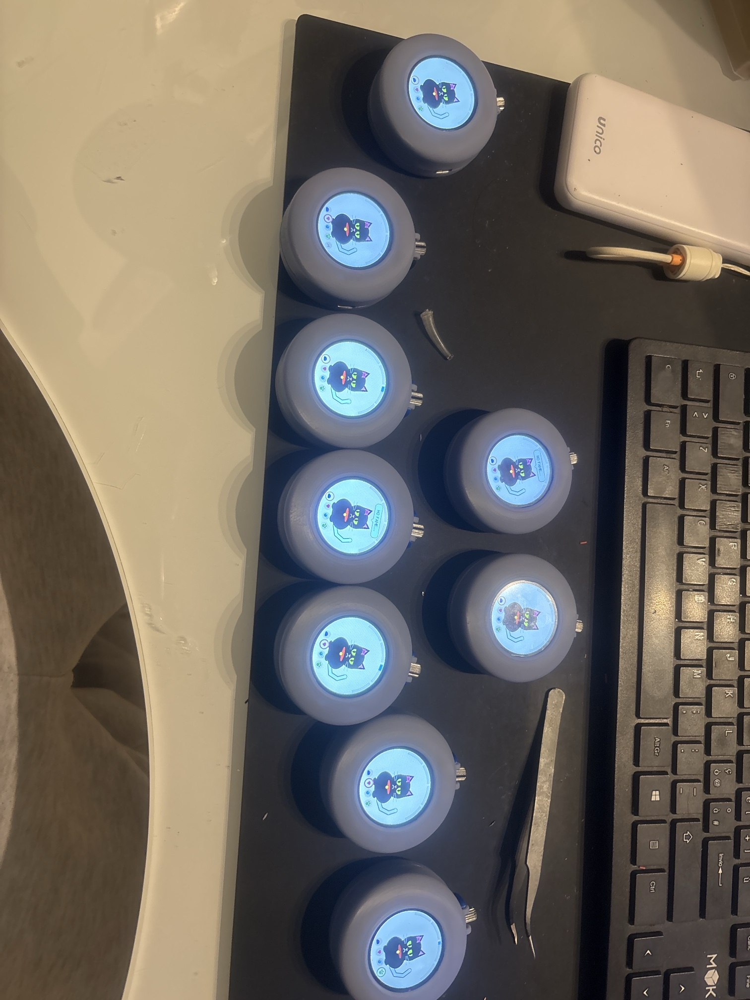
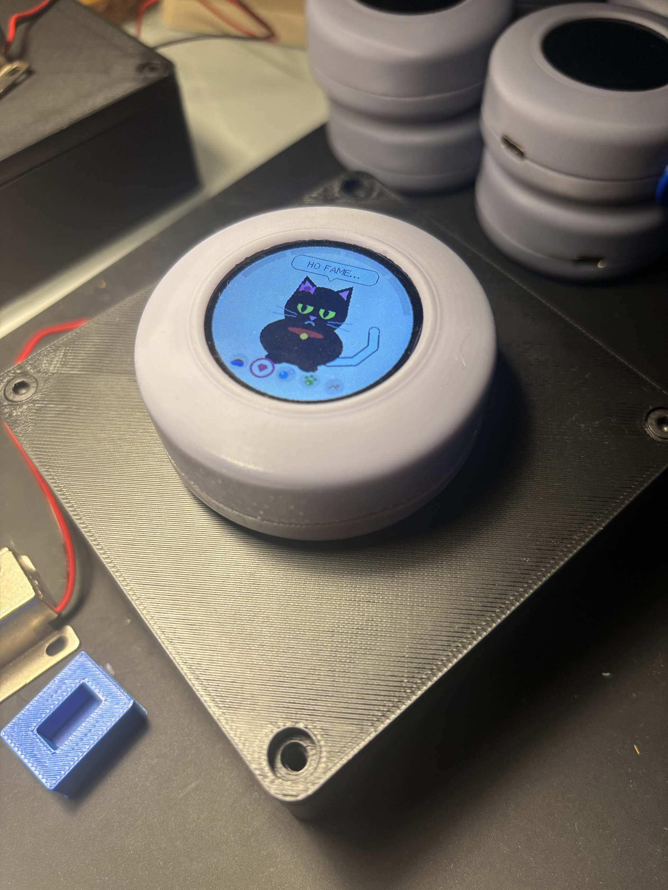
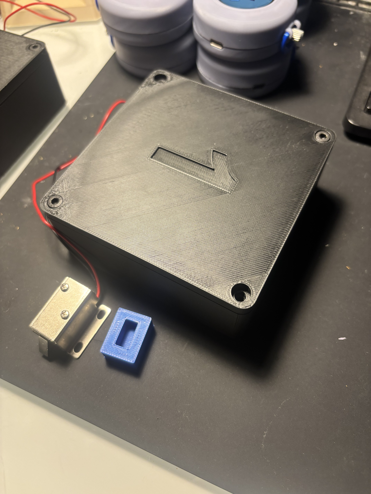
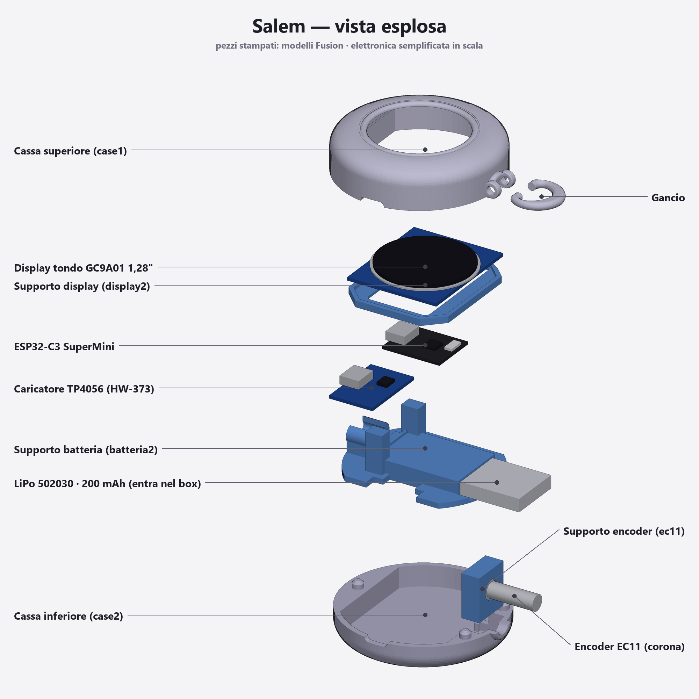

# Salem — an escape-room pocket watch with a Tamagotchi inside

Salem is a black cat living inside an electronic pocket watch. Players take care of her, use her to hunt for clues, and finally turn her into a clock whose correct time unlocks a box. Nine watches and two wireless locks were built for a live escape-room event.



| | |
|---|---|
|  |  |

## What it does

| Phase | What the players do |
|---|---|
| 1 — Requests | Salem asks for food, cuddles, a bath or a walk. Each request done fills a quarter of a bar; after 16 requests a hidden bonus opens **lock 1** (only when standing next to it). |
| 2 — Treasure hunt | At every clue the team picks a scene (sunset or night) and a move. The right sequence of 8 opens a 3-digit padlock on screen, then a map. Every team has its own sequence. |
| 3 — Free play | Just the cat: bars slowly drain, she complains when hungry. |
| 4 — Clock | A secret Morse code on the crown turns the cat into a watch face. Setting the right time sends it by radio and opens **lock 2**. |

Everything is driven by one rotary crown: turn to choose, click to act, hold 3 s to enter a secret code. A staff menu (code + PIN) starts the phases, picks the team and tests the locks.

## Hardware



**Watch** (×9)

| Part | Notes |
|---|---|
| ESP32-C3 SuperMini | ESP-NOW radio, 4 MB flash |
| GC9A01 1.28" round display, 240×240 | SPI at 27 MHz, backlight on a GPIO |
| EC11 rotary encoder with push button | the crown |
| LiPo 502030, 200 mAh + TP4056 charger with protection | charging port reachable from outside the case |
| Resin-printed pocket-watch case | |

Wiring: display SCL 4, SDA 3, RES 2, DC 1, CS 0, BLK 5 · encoder A 20, B 21, button 10.

**Lock** (×2)

| Part | Notes |
|---|---|
| ESP32-C3 SuperMini | receives the watch over ESP-NOW |
| 5 V relay on GPIO4 | on the normally-open contact |
| 5 V → 12 V step-up | |
| 12 V solenoid latch (pin type) | retracts when powered, 1N4007 flyback diode across it |

## Firmware

```
firmware/
├── salem/        the watch: salem.ino + config.h (all game settings), quadrante.h (dial), mappa.h (map), autotest.h
└── lock/         the lock: set CASSETTA = 1 or 2 at the top
tools/
├── upload.ps1    builds and uploads the watch firmware (normal or test build)
├── stress_orologio/   10-minute hardware stress test for a watch
└── test_schermo/      display and crown check
```

Arduino IDE settings: board **ESP32C3 Dev Module**, **USB CDC On Boot: Enabled**, partition scheme **Huge APP** (watch only). Libraries: ESP32 core 3.3.x, LovyanGFX 1.2.x.

Every game setting — texts, team names, passwords, routes, secret codes, timings — lives in `firmware/salem/config.h`. The values in this repository are **examples**; the real event used different ones.

### Things worth knowing

- **Radio**: ESP-NOW broadcast with retries and a sequence number; the lock answers by unicast to the sender. The watch's radio is only switched on while sending, and the "only from close by" rule for lock 1 is an RSSI threshold on the lock.
- **Battery**: with the screen off the watch goes into light sleep (about 1 mA). On the ESP32-C3 the pads are released in light sleep, so the display backlight turned itself back on — `gpio_sleep_sel_dis` and `gpio_hold_en` on the backlight pin fixed a 30 mA standby drain.
- **Flat battery**: the TP4056 has no power path, so a fully discharged watch plugged into a charger would boot, eat the whole trickle current and hang. After a brownout reset the watch now deep-sleeps for 60 s and lets the battery recover, then restarts on its own.
- **Memory**: the 240×240 16-bit frame buffer needs one 115 KB block. Inside `setup()` the largest free block is a few hundred bytes too small, so the sprite is created in a global constructor, before the system tasks fragment the heap.
- **Self-test**: building with `-DSALEM_AUTOTEST` (`tools/upload.ps1 test`) makes the watch play the whole game by itself five times — 745 state checks per run — with the radio simulated. It caught nothing on the nine production watches, which is the point.

## Licence

Code under the MIT licence (see `LICENSE`). The dial and the map in this repository are original drawings made for publication.
